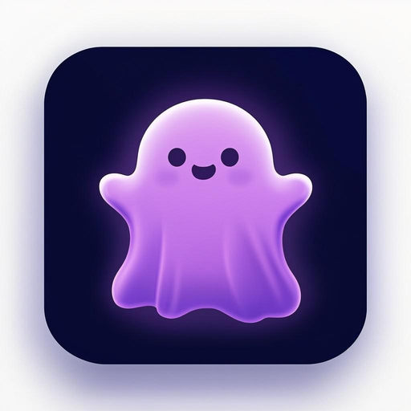
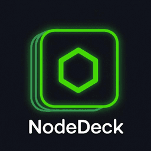
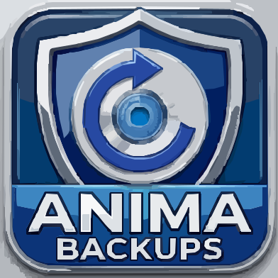
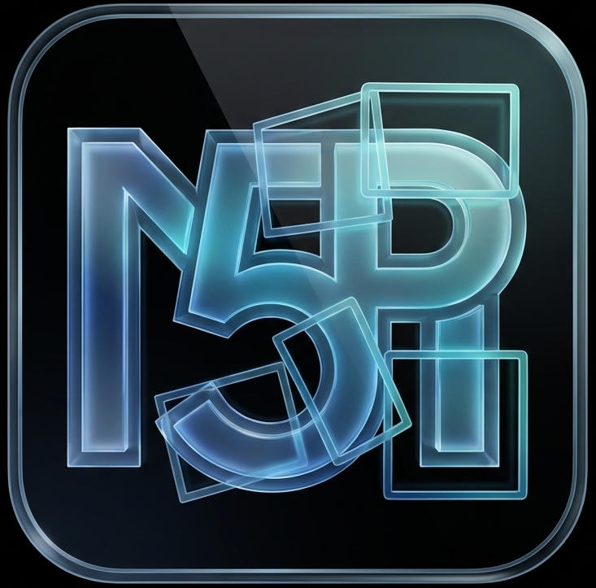

 

---

## About me

I'm **Mario Ramos**, a systems developer and open-source contributor from Spain.

I design and build software across the stack, from native system integrations and desktop applications to developer tools, automation and infrastructure. My main engineering focus is **Rust, Tauri 2, TypeScript and Linux**.

I enjoy solving problems close to the operating system: native APIs, hardware interfaces, process management, multimedia, cross-platform behaviour, testing and release engineering. I also contribute upstream to established open-source projects, including **Tauri, Tao and Microsoft tgrep**.

-  **Systems programming:** Rust, native integrations and platform APIs.
-  **Desktop development:** Tauri 2, TypeScript and cross-platform applications.
-  **Linux engineering:** desktop environments, bootable systems, automation and infrastructure.
-  **Open source:** upstream bug fixes, features, tests, documentation and release contributions.

### Current focus

---

## GitHub Analytics

<table>
  <tr>
    <td colspan="2" align="center">
      
    </td>
    <td colspan="2" align="center">
      
    </td>
  </tr>
  <tr>
    <td colspan="2" align="center">
      
    </td>
    <td colspan="2" align="center">
      
    </td>
  </tr>
</table>

##  Open-source contributions

I contribute to upstream projects through bug investigation, implementation, regression tests, documentation and maintenance. My merged work spans the Tauri ecosystem, Microsoft and GoogleCloudPlatform projects, alongside contributions across my own open-source repositories.

### Upstream contributions

| Project | Pull request | Contribution | Result |
|:--|:--:|:--|:--:|
|  **Tauri** | [#16057](https://github.com/tauri-apps/tauri/pull/16057) | Guard environment-variable modifications in tests with `serial_test` |  |
|  **Tauri** | [#16280](https://github.com/tauri-apps/tauri/pull/16280) | Suggest the closest permission identifier when an unknown ACL permission is encountered |  |
|  **Tao** | [#1351](https://github.com/tauri-apps/tao/pull/1351) | Handle failed Linux display initialisation as `Unavailable` in raw display handles |  |
|  **Microsoft tgrep** | [#178](https://github.com/microsoft/tgrep/pull/178) | Implement `Error::source()` and add 13 tests for the error module |  |
|  **Google GenMedia Creative Studio** | [#1912](https://github.com/GoogleCloudPlatform/genmedia-creative-studio/pull/1912) | Add a deprecation banner and audit deprecated `mcp-imagen-go` references |  |
|  **Google GenMedia Creative Studio** | [#1915](https://github.com/GoogleCloudPlatform/genmedia-creative-studio/pull/1915) | Route users away from deprecated `mcp-imagen-go` |  |

### Tauri ecosystem - release contributions

My contributions are part of the upstream Tauri and Tao projects and their release history. This goes beyond maintaining personal repositories: I actively contribute fixes and improvements to software used by the wider ecosystem.

---

##  My software

  <table>
    <tr>
      <td align="center" width="180">
        <a href="https://github.com/marrionesa/animabooter">
           
          <b>AnimaBooter</b>
        </a>
         Bootable media tooling · Rust + Tauri 2
      </td>
      <td align="center" width="180">
        <a href="https://github.com/marrionesa/nodedesk">
           
          <b>NodeDesk</b>
        </a>
         Developer tooling · TypeScript monorepo
      </td>
      <td align="center" width="180">
        <a href="https://github.com/marrionesa/animacam-os">
           
          <b>AnimaCAM-OS</b>
        </a>
         iPhone camera and video workflows
      </td>
      <td align="center" width="180">
        <a href="https://github.com/marrionesa/animabackup">
           
          <b>AnimaBackup</b>
        </a>
         Backup tooling · In development
      </td>
      <td align="center" width="180">
        <a href="https://github.com/marrionesa/mp5-website">
           
          <b>MP5</b>
        </a>
         Adaptive video platform
      </td>
    </tr>
  </table>

---

##  Tauri plugins & ecosystem

I build native plugins and reusable components for **Tauri v2**, exposing operating-system capabilities to cross-platform desktop and mobile applications.

| Plugin / project | Description | Stack |
|:--|:--|:--:|
| [tauri-plugin-power-monitor](https://github.com/marrionesa/tauri-plugin-power-monitor) | Battery state, power source and system sleep/wake events across Windows, macOS and Linux |  |
| [tauri-plugin-brightness](https://github.com/marrionesa/tauri-plugin-brightness) | Display brightness control through DDC/CI, `ddcutil` and Linux backlight interfaces |  |
| [tauri-plugin-ad2mob](https://github.com/marrionesa/tauri-plugin-ad2mob) | Google AdMob integration for Tauri v2 on Android and iOS |  |
| [tauri-plugins](https://github.com/marrionesa/tauri-plugins) | Six standalone plugins: beep, hash, hostname, mimetype, timezone and UUID |  |
| [animacamos-core-public](https://github.com/marrionesa/animacamos-core-public) | Shared camera and video primitives for AnimaCAM applications |  |

 

##  Tech stack

### Languages

### Frameworks & application development

### Systems, infrastructure & databases

##  Find me online

  
  
  
  
  

  Engineering useful software, contributing upstream and learning by shipping.

  

 

